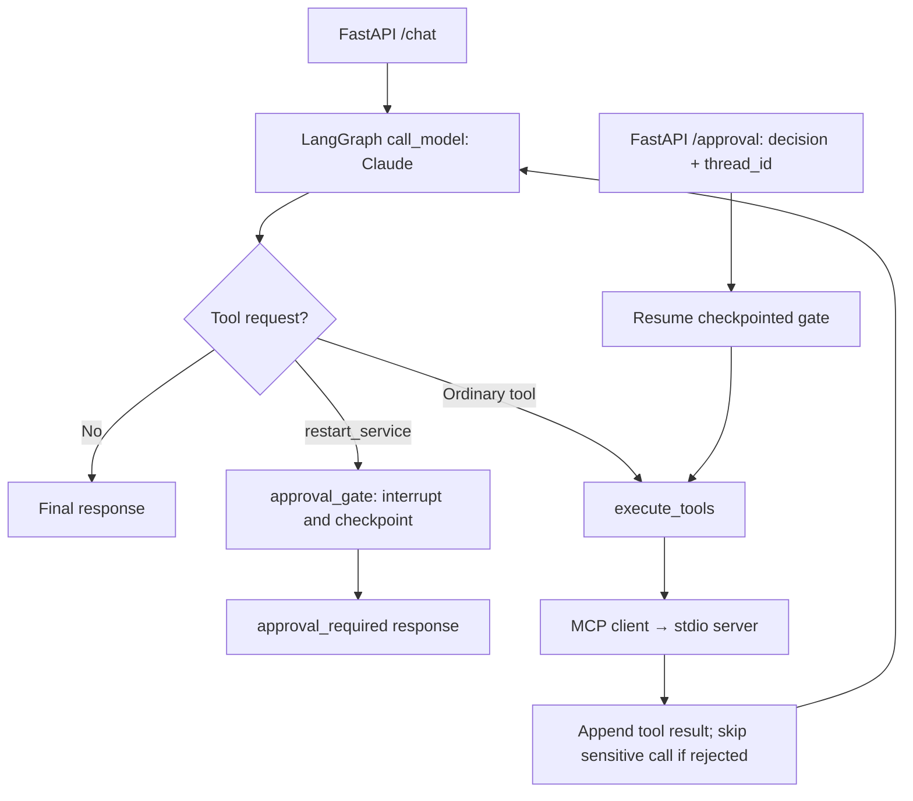

# Secure Agent Platform

An operations assistant needs more than a plausible answer: it needs access to internal knowledge, explicit control over sensitive actions, and a way to inspect what happened. Secure Agent Platform is a learning and portfolio project that demonstrates those concerns in a runnable FastAPI application using Claude, LangGraph, MCP, and PostgreSQL.

Ask about service health, investigate incidents, retrieve runbook guidance, and request a simulated service restart that pauses for human approval. Follow the model requests, tool execution, and retrieved evidence in live structured logs.

## What the demo demonstrates

- **Application-controlled tool execution.** Claude selects tools; a LangGraph workflow routes and executes them through an MCP server over stdio.
- **Durable conversation and workflow state.** PostgreSQL checkpoints preserve message history and pending approvals by `thread_id`, including across application restarts.
- **Human approval before a sensitive action.** A `restart_service` request interrupts the graph before execution. A separate `/approval` request resumes it with an approve or reject decision.
- **Local retrieval and reranking.** Sentence Transformers embeddings, pgvector cosine search, PostgreSQL full-text search, Reciprocal Rank Fusion, and a local cross-encoder retrieve relevant document chunks. Search supports service, document type, and environment filters.
- **Visible execution.** Guided labs, named Swagger examples, and expandable JSON logs expose the path from HTTP request through model and MCP calls to the final response.

This is a local demonstration of production-style patterns. Service health and restarts are simulated; incident queries read PostgreSQL. Embeddings and reranking run locally, while model responses use the Anthropic API. The approval gate is enforced by the application graph, rather than by asking the model to obtain permission.

## Run locally

Prerequisites: Python 3.14 or newer, `uv`, Docker Compose, and Anthropic credentials.

From the repository root, copy the environment template and install dependencies:

```bash
cp .env.example .env
uv sync
```

Fill in `ANTHROPIC_API_KEY` and `ANTHROPIC_WORKSPACE_ID` in `.env`. The model, database, embedding, and reranker settings can normally stay at their defaults for this demo.

Start PostgreSQL with pgvector:

```bash
docker compose up -d postgres
```

The image is `pgvector/pgvector:pg17`. Wait for PostgreSQL to be healthy before ingestion. If an older RAG table has a different vector dimension, the application drops and recreates only the derived `document_chunks` table; the incident table is left intact.

Ingest the sample knowledge base:

```bash
uv run python -m app.ingest knowledge
```

This reads `.md` and `.txt` files, splits them into overlapping chunks, embeds them locally, and stores chunks and vectors in PostgreSQL. Re-running ingestion replaces the stored chunks for each source file. Optional `metadata.json` supplies per-document search metadata.

The default embedding model is `sentence-transformers/all-MiniLM-L6-v2` (384 dimensions); the reranker is `cross-encoder/ms-marco-MiniLM-L6-v2`. Initial use downloads the models; subsequent embedding and reranking work runs locally. The MCP server warms both models at startup. No OpenAI API key is required.

Run the tests and start the API:

```bash
uv run pytest
uv run uvicorn app.main:app --reload
```

## Walk through the demo

Keep these views open alongside the Uvicorn terminal:

| View | Purpose |
| --- | --- |
| [Learning labs](http://127.0.0.1:8000/learn) | Guided steps and explanations of the control flow |
| [Swagger API](http://127.0.0.1:8000/docs) | Execute requests using the named examples |
| [Live logs](http://127.0.0.1:8000/logs) | Filter by trace or thread and expand structured events |

On macOS or Linux, after the server is running, open all three with:

```bash
./scripts/open-lab
```

The helper only opens browser tabs; it does not start the server or send requests.

1. **Inspect a tool call.** In `/learn`, follow the safe MCP tool lab. In `/docs`, open `POST /chat`, click **Try it out**, select **2. Safe MCP tool call**, and execute. In `/logs`, follow Claude's `tool_use` request, the MCP request/result, and the final answer. Example **3. PostgreSQL tool call** adds incident history to the investigation.
2. **Retrieve runbook evidence.** Execute **4. RAG retrieval and reranking**: “How much clock skew does token validation allow? Use the internal documentation.” Expand `rag.request` and `rag.response` in `/logs` and compare the returned chunks with the answer.
3. **Continue a durable conversation.** Execute **5a. Persistence: start a thread**, copy the returned `thread_id`, then paste it into **5b. Persistence: continue a thread**. The second request restores the earlier message state. Stop and restart Uvicorn between requests to demonstrate persistence across processes.
4. **Pause and resume a sensitive action.** Execute **6. HITL: request a sensitive action**. Expect `status: "approval_required"`; inspect `approval.details` and copy the `thread_id`. The simulated restart has not executed. In `POST /approval`, select the approve or reject example and paste that thread ID. Approval allows the simulated restart; rejection skips it and returns a tool error to the model. Inspect `agent.approval.required` and the resumed execution in `/logs`. Repeat with a fresh request to try the other decision, or restart Uvicorn before submitting the decision to demonstrate durable interruption.

Each HTTP execution has its own trace ID; the thread ID connects persisted conversation state across requests. `POST /chat` generates a thread ID when one is omitted. `/approval` returns HTTP 409 if that thread has no pending approval.

The full [learning labs](labs/) also include a plain model response without tool execution. Other runbook questions to try:

```text
When should an authentication deployment be rolled back?
What is the billing webhook retry schedule?
At what queue depth is the documents service considered critical?
```

## Architecture

FastAPI owns a persistent MCP subprocess and a PostgreSQL-backed LangGraph checkpointer for the application lifetime. The MCP client discovers tools with `tools/list` and executes model-selected calls with `tools/call`.



`AgentState` holds accumulated messages, trace ID, turn count, stop reason, answer, and approval decision. The graph cycles through `call_model` and `execute_tools` until Claude returns a final response; `approval_gate` interrupts before the sensitive tool. PostgreSQL stores checkpoints keyed by `thread_id`.

| MCP tool | Implementation |
| --- | --- |
| `get_system_status` | Simulated service health and latency |
| `get_incidents` | Recent incidents from PostgreSQL |
| `search_documents` | Hybrid retrieval with metadata filters and local reranking |
| `restart_service` | Simulated restart, gated by application-controlled human approval |

The RAG pipeline has a separate ingestion path:

- **Ingestion:** `knowledge/` → overlapping chunks → local Sentence Transformers embeddings → PostgreSQL document chunks, vectors, text-search index, and metadata.
- **Retrieval:** `search_documents` → local query embedding → pgvector cosine and full-text candidate searches → Reciprocal Rank Fusion → local cross-encoder reranking → chunks returned as an MCP tool result → Claude's answer.

Implementation entry points: [HTTP API](app/main.py), [graph and approval policy](app/agent_graph.py), [checkpoint runtime](app/checkpoint_runtime.py), [MCP tools](app/mcp_server.py), and [retrieval](app/rag.py).

Development tracing is configured in `.env`: `TRACE_PAYLOADS=true` includes user, tool, and document text, bounded by `TRACE_MAX_CHARS`. Set `TRACE_PAYLOADS=false` when that content should not be logged. The live viewer is enabled by default and can be disabled with `LOG_VIEWER_ENABLED=false`.

## Inspect MCP directly

```bash
uv run mcp dev app/mcp_server.py
```

Or run it over stdio:

```bash
uv run python -m app.mcp_server
```

Direct MCP inspection bypasses the FastAPI/LangGraph approval workflow; use `/chat` and `/approval` to demonstrate the gate.
